# Stuxnet Memory Forensics with Redline

Memory forensics investigation of a Windows XP memory image (`.vmem`) infected with **Stuxnet**, using **Mandiant Redline** and a **Stuxnet IOC** (Indicator of Compromise).

**Goal:** identify the malicious processes Stuxnet created, prove which `lsass.exe` is legitimate, and confirm the infection with an automated IOC sweep.

---

## Tools & Data

| Item | Purpose |
|---|---|
| Mandiant Redline | Memory image analysis (processes, handles, memory sections, strings, timeline) |
| Stuxnet memory capture (`.vmem`) | Windows XP VM RAM snapshot taken after infection |
| Stuxnet IOC (OpenIOC format) | Automated checklist of Stuxnet indicators |

> The malware sample and memory image are **not** included in this repository.

---

## Key Concepts

- **Memory forensics:** RAM shows what was running at capture time, including code that never touches disk.
- **lsass.exe:** Windows Local Security Authority (logins, passwords, security policy). **Only one** should exist.
- **Process injection / hollowing:** malware writes its code into trusted processes, or starts a real process paused, swaps its code, and resumes it.
- **IOC:** a file of clues written by researchers after studying a piece of malware. Tools like Redline check a system against it automatically.

---

## Attack Timeline

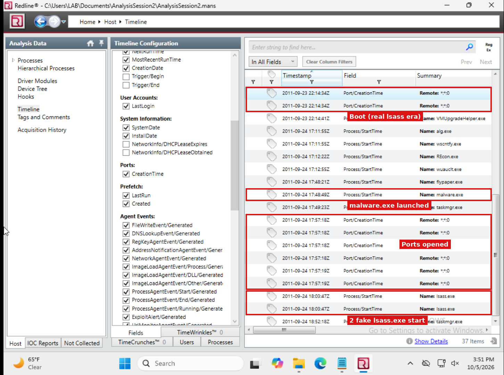

| Time (UTC) | Event |
|---|---|
| 2011-09-23 22:14 | System boots; legitimate lsass (PID 692) starts under winlogon.exe |
| 2011-09-24 17:12–17:48 | Analyst monitoring tools start (REcon, flypaper) |
| 2011-09-24 17:48:49 | **malware.exe (Stuxnet) launched** |
| 2011-09-24 17:57 | Network ports opened |
| 2011-09-24 18:03:47 | **Two fake lsass.exe (3464, 3472) spawned by services.exe** |

---

## Investigation

### Q1. How many instances of lsass.exe are running?

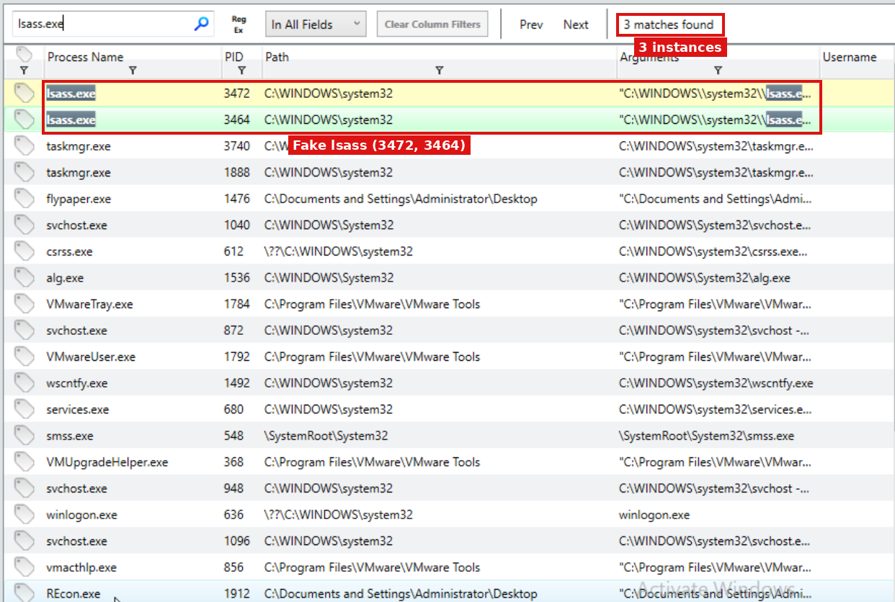

**Answer:** **3** instances (PIDs 3472, 3464, 692).

---

### Q2. Record each lsass PID and Parent PID

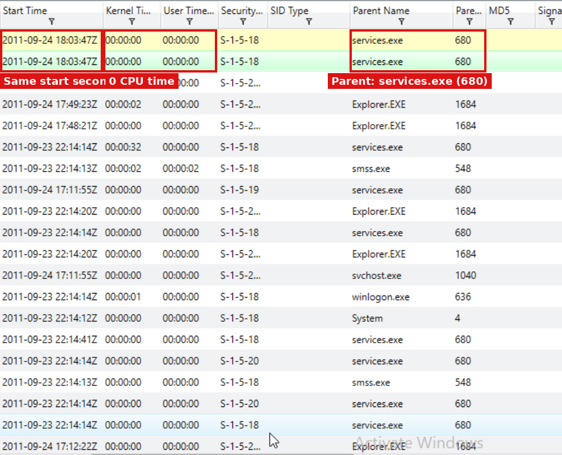
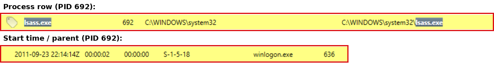

| lsass PID | Parent PID |
|---|---|
| 3472 | 680 |
| 3464 | 680 |
| 692 | 636 |

---

### Q3. What is the parent name for each lsass?

| lsass PID | Parent Name |
|---|---|
| 3472 | services.exe |
| 3464 | services.exe |
| 692 | winlogon.exe |

*(Evidence: same screenshots as Q2, Parent Name column.)*

---

### Q4. What is the normal parent process for lsass?

**Answer:** On **Windows XP** (this image), the normal parent is **winlogon.exe**. On Vista and later, it is **wininit.exe**. Only PID 692 has the correct parent.

---

### Q5. What is unusual about the lsass entries themselves?

| Detail | Real lsass (692) | Fakes (3464, 3472) |
|---|---|---|
| Arguments | `C:\WINDOWS\system32\lsass.exe` | `"C:\WINDOWS\\system32\\lsass.exe"` (double backslashes, quoted) |
| Start time | 2011-09-23 22:14:14Z (boot) | 2011-09-24 18:03:47Z, same second, ~20 hrs after boot |
| Kernel/User time | 00:00:02 | 00:00:00 (no real work) |
| Count | Should be the only one | Two extra copies |

**Answer:** PIDs 3464 and 3472 have malformed double-backslash arguments, started at the exact same second long after boot, and show zero CPU time, consistent with process hollowing.

---

### Q6. Which PIDs had injected memory sections?

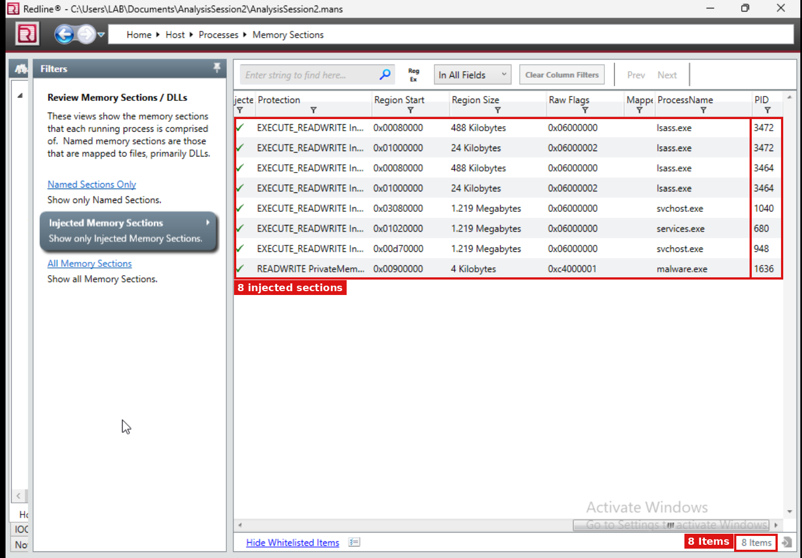

| PID | Process | Injected Sections |
|---|---|---|
| 3472 | lsass.exe | 2 |
| 3464 | lsass.exe | 2 |
| 1040 | svchost.exe | 1 |
| 680 | services.exe | 1 |
| 948 | svchost.exe | 1 |
| 1636 | malware.exe | 1 |

**Answer:** 8 injected sections across 6 PIDs. Red flags: `EXECUTE_READWRITE` protection (writable + executable), no mapped file on disk, and identical payload sizes repeated across processes. The legitimate lsass (692) had **no** injected memory.

---

### Q7. Which lsass has handles to HKLM\SECURITY, HKLM\SECURITY\RXACT, and HKLM\SECURITY\POLICY?

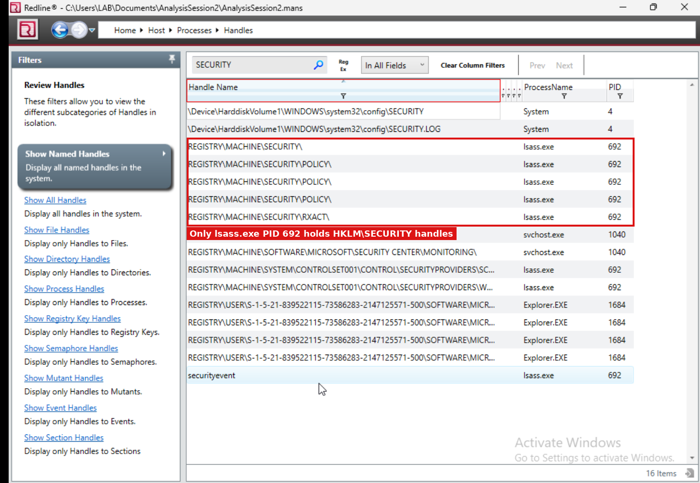

**Answer:** Only **PID 692**. The real lsass must open the SECURITY hive to do its job; the fakes only wear the name and hold no such handles. This proves 692 is legitimate based on **behavior**, not just appearance.

---

### Q8. Which processes have RealTek embedded in their memory?

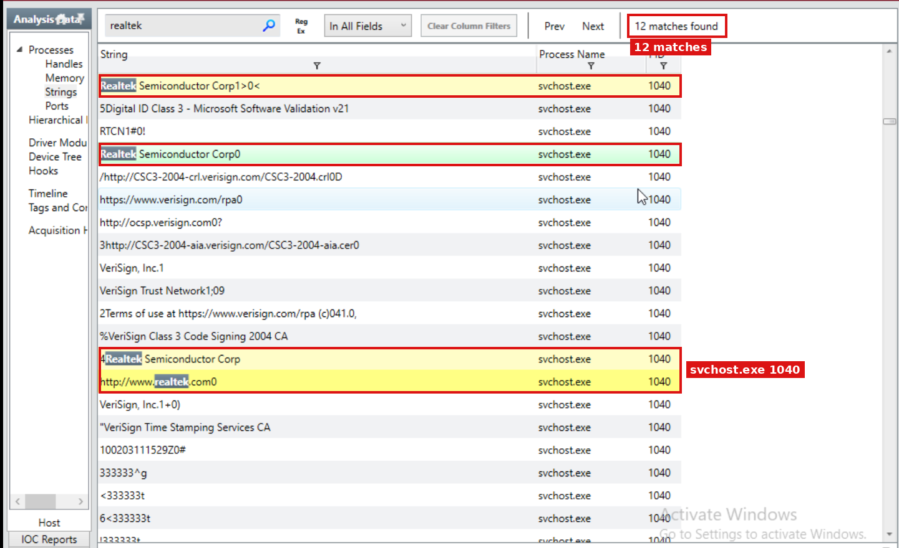
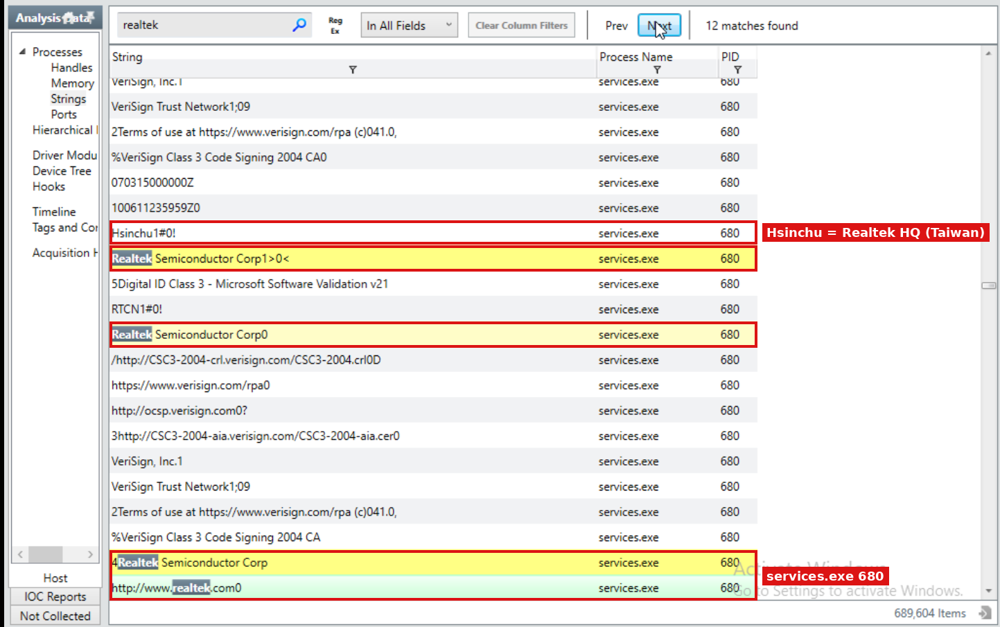
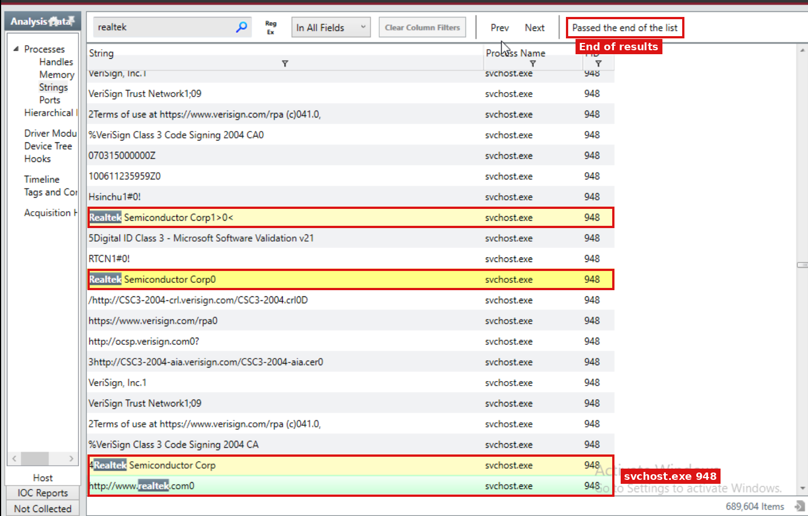

**Answer:** **svchost.exe (1040)**, **services.exe (680)**, and **svchost.exe (948)**, with 4 matches each (12 total).

The surrounding strings (`Realtek Semiconductor Corp`, `Hsinchu`, `VeriSign Class 3 Code Signing 2004 CA`) are the **stolen Realtek code-signing certificate** Stuxnet used to make its drivers look trusted. All three processes also had injected memory (Q6).

---

### Q9. Run the Stuxnet IOC. Which PIDs have the most indicator hits?

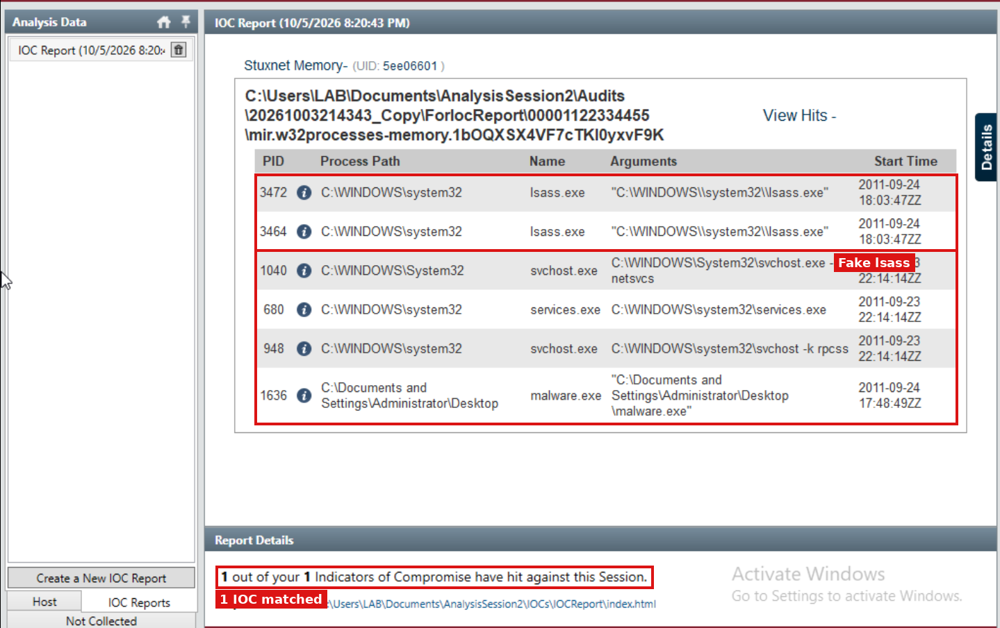

**PID 3472:**
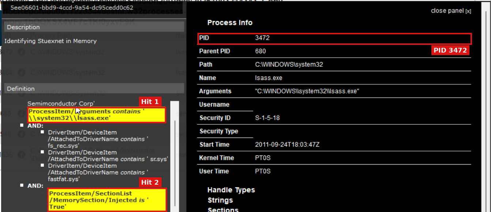

**PID 3464:**
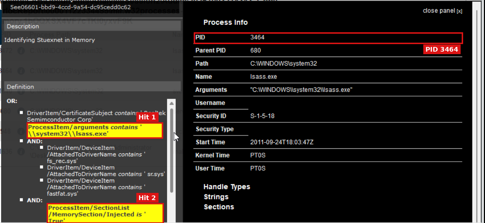
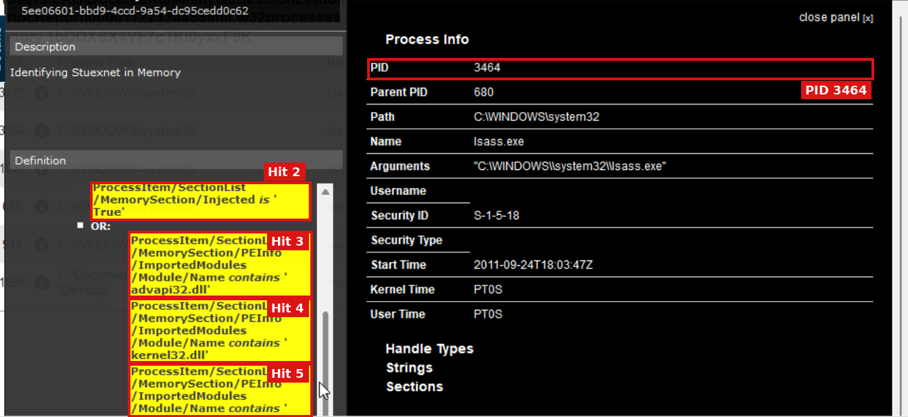

| # | Indicator | 3472 | 3464 |
|---|---|---|---|
| 1 | Arguments contain `\\system32\\lsass.exe` | ✅ | ✅ |
| 2 | Memory section injected = True | ✅ | ✅ |
| 3 | Imports advapi32.dll | ✅ | ✅ |
| 4 | Imports kernel32.dll | ✅ | ✅ |
| 5 | Imports a third module | ✅ | ✅ |

**Answer:** **PIDs 3472 and 3464** have the most hits (5 each). The lsass-arguments indicator can only match the fake lsass processes, so the other matched PIDs (1040, 680, 948, 1636) score lower. The IOC's matched PIDs exactly mirror the manual injection findings from Q6.

---

### Q10. How many lsass instances should exist normally?

**Answer:** **One.** It starts at boot from winlogon.exe (XP) or wininit.exe (Vista+). Here that is PID 692; 3464 and 3472 are Stuxnet's fakes.

---

## Summary: Attack Chain

1. **malware.exe** (PID 1636) is executed.
2. Stuxnet injects code into **services.exe (680)** and **svchost.exe (1040, 948)**, carrying the stolen **Realtek** certificate data.
3. services.exe spawns **two hollowed lsass.exe processes (3464, 3472)** to hide Stuxnet under a trusted name.
4. The fakes betray themselves through the wrong parent, malformed arguments, late start time, zero CPU time, injected memory, and missing SECURITY handles.
5. The **Stuxnet IOC** independently confirms all six infected PIDs.

## Skills Demonstrated

- Memory image analysis with Mandiant Redline
- Process tree and parent-child anomaly detection
- Identifying process injection and process hollowing
- Handle analysis to verify process legitimacy by behavior
- String analysis and certificate artifact identification
- IOC-based threat hunting (OpenIOC)
- Timeline reconstruction

## References

- Mandiant Redline: free host investigation and memory analysis tool
- Stuxnet: first publicly discovered in 2010 by VirusBlokAda; drivers signed with stolen Realtek and JMicron certificates
